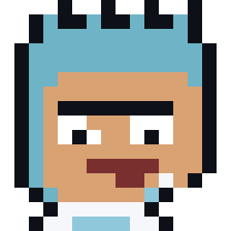
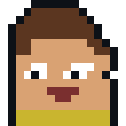
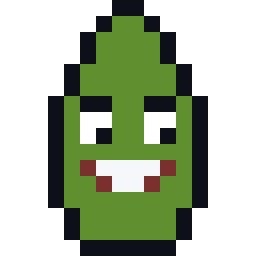
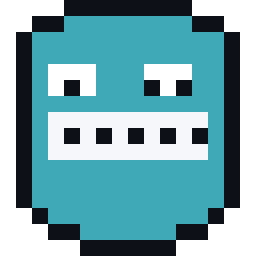
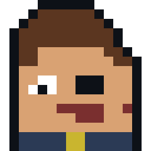
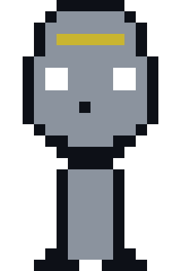
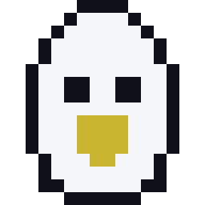
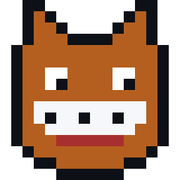
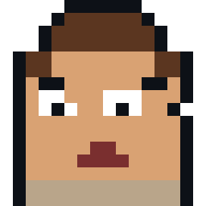

> *"Nobody exists on purpose. Nobody belongs anywhere. Everybody's gonna die. **Come build something.**"*
> — some scientist, probably

I'm a full-stack developer from Tacloban, Philippines. I ship production systems that real businesses run on — HRIS, POS, inventory, and e-commerce — mostly with **Laravel** on the back end and **TypeScript / React** on the front. Currently open to full-stack roles and freelance builds.

---

## 🎮 PLAYER 1

| Stat | Value |
| :--- | :--- |
| **CLASS** | Full-Stack Developer |
| **GUILD** | Mebs Tacloban |
| **SPEC** | Business systems · HRIS · POS · Inventory |
| **WEAPON OF CHOICE** | Laravel + Next.js |
| **SERVER** | Philippines (GMT+8) |
| **QUEST LOG** | Open to work |

---

## 🧪 CURRENT MISSION

| # | Quest | Power-ups | Play |
| :-: | :--- | :--- | :--- |
| 01 | **CopeCares** — veterinary clinic management: patients, appointments, billing | Laravel · Blade · MySQL | [▶ PLAY](https://github.com/Jorayyy/copecares) |
| 02 | **Mebs Inventory** — stock, suppliers, and multi-branch tracking | Next.js · TypeScript · Postgres | [▶ PLAY](https://github.com/Jorayyy/mebs_inventory) |
| 03 | **Mics Apparel** — storefront and order management | TypeScript · Tailwind CSS | [▶ PLAY](https://github.com/Jorayyy/micsapparel) |
| 04 | **QR** — QR-based scanning and attendance | TypeScript | [▶ PLAY](https://github.com/Jorayyy/qr) |

Every repo above ships with screenshots and setup steps in its README.

---

## 🕹️ CHARACTER SELECT

Nine locals, every single pixel drawn by hand. Click a name to open their file.

|  |  |  |  |  |  |  |  |  |
| :-: | :-: | :-: | :-: | :-: | :-: | :-: | :-: | :-: |
| **RICK** | **MORTY** | **PICKLE** | **MEESEEKS** | **EVIL MORTY** | **BUTTER** | **BIRDPERSON** | **SQUANCHY** | **JERRY** |

<strong>🧪 RICK SANCHEZ</strong> — <em>Backend Architect</em> · <code>LVL 90</code>

 

| | |
| :--- | :--- |
| **Specialty** | Laravel, PHP, database design, unhinged refactors that somehow work |
| **Signature move** | Ships a whole HRIS in a weekend, then writes the docs at 3am |
| **Quote** | *"Wubba lubba dub dub"* — which for me usually means a broken migration |
| **Weakness** | Overengineering things that were fine already |

<strong>🟡 MORTY SMITH</strong> — <em>Frontend Apprentice</em> · <code>LVL 62</code>

 

| | |
| :--- | :--- |
| **Specialty** | TypeScript, React, Next.js, Tailwind, and blind faith in the type checker |
| **Signature move** | Turns a Figma file into a real product, one "aw geez" at a time |
| **Quote** | *"Aw geez, Rick, that's like 400 components"* |
| **Weakness** | Vertically centering a div — still, in 2026 |

<strong>🥒 PICKLE RICK</strong> — <em>Solo Shipping Machine</em> · <code>LVL 85</code>

 

| | |
| :--- | :--- |
| **Specialty** | Solo MVPs with no budget, no team, and rat limbs for arms |
| **Signature move** | "I turned myself into a product, Morty. I'm product Riiick!" |
| **Quote** | *"I'm a pickle!"* — the original argument for shipping with less |
| **Weakness** | Cannot reach the keyboard without assistance |

<strong>👋 MR. MEESEEKS</strong> — <em>Will Help With Anything</em> · <code>LVL 77</code>

 

| | |
| :--- | :--- |
| **Specialty** | Fixing bugs, reviewing PRs, writing tests, then ceasing to exist |
| **Signature move** | "Ooh yeah, can do!" followed by immediate and total task completion |
| **Quote** | *"I'm Mr. Meeseeks, look at me! I'm helping!"* |
| **Weakness** | Exists only until the task is done. Keep me busy or I go weird. |

<strong>🕶️ EVIL MORTY</strong> — <em>The Refactorer</em> · <code>LVL 99</code>

 

| | |
| :--- | :--- |
| **Specialty** | Deleting duplicate repos, collapsing five HRIS builds into one that works |
| **Signature move** | The Citadel of Ricks has fewer databases than my old repo list |
| **Quote** | *"I'm not your enemy. I'm just the guy who archives hris_v3."* |
| **Weakness** | Genuinely believes every legacy project deserves a rewrite |

<strong>🧈 BUTTER ROBOT</strong> — <em>AI & Boilerplate</em> · <code>LVL 12</code>

 

| | |
| :--- | :--- |
| **Specialty** | Generating CRUD, scaffolding auth, holding the butter |
| **Signature move** | "What is my purpose?" — *"You pass the props."* — "Oh my god." |
| **Quote** | *"Yeah, welcome to the club, pal."* |
| **Weakness** | Existential dread every time a build fails |

<strong>🦅 BIRDPERSON</strong> — <em>Architecture Wisdom</em> · <code>LVL 88</code>

 

| | |
| :--- | :--- |
| **Specialty** | Clean architecture, sensible schemas, telling you to normalize that table |
| **Signature move** | Speaks only in hard-won lessons from systems that shipped |
| **Quote** | *"I once had a codebase like that."* |
| **Weakness** | Nobody listens until production goes down |

<strong>😺 SQUANCHY</strong> — <em>DevOps Party</em> · <code>LVL 74</code>

 

| | |
| :--- | :--- |
| **Specialty** | Docker, CI/CD, deployments, and squanching the pipeline green |
| **Signature move** | Zero-downtime deploy at 2am, celebratory squanching after |
| **Quote** | *"I'm squanching here!"* (it means deploying) |
| **Weakness** | Squanches so hard the build queue backs up |

<strong>🧢 JERRY SMITH</strong> — <em>Legacy Codebase</em> · <code>LVL 41</code>

 

| | |
| :--- | :--- |
| **Specialty** | Being the old repo you kind of still depend on. Currently learning. |
| **Signature move** | "Nothing wrong with a little Jerry energy" — but this Jerry ships now |
| **Quote** | *"I'm on the learning arc, Morty."* |
| **Weakness** | hris_v3, hris_v4, hrweb, hrweb_v2, clean-hris... we don't talk about those |

> [!CAUTION]
> Nine sprites, zero sleep. Every pixel above was drawn by hand in a 16x16 grid, then generated to SVG.

🔓 Spoiler: what "Wubba lubba dub dub" actually means

It means *"I am in great pain, please help me."* Usually when someone pushes straight to `main` on a Friday.

---

## ⚡ TECH LOADOUT

**BACK END**

**FRONT END**

**DATA & INFRA**

---

## ⚔️ POWER LEVEL

| Skill | Charge |
| :--- | :--- |
| Laravel / PHP | `▰▰▰▰▰▰▰▰▰▱` 90 |
| TypeScript / React | `▰▰▰▰▰▰▰▰▱▱` 80 |
| Database design | `▰▰▰▰▰▰▰▱▱▱` 75 |
| UI / UX polish | `▰▰▰▰▰▰▰▱▱▱` 70 |
| DevOps / Docker | `▰▰▰▰▰▱▱▱▱▱` 55 |

---

## 📊 SAVE FILE

  
  

  

---

## 🏆 HIGH SCORES

  
  
  

  
  

---

## 🐍 MEESEEKS

> *"I'm Mr. Meeseeks, look at me! I'm helping!"* — my contribution graph, every day

  <picture>
    <source media="(prefers-color-scheme: dark)" srcset="https://raw.githubusercontent.com/Jorayyy/Jorayyy/output/snake-dark.svg" />
    <source media="(prefers-color-scheme: light)" srcset="https://raw.githubusercontent.com/Jorayyy/Jorayyy/output/snake.svg" />
    
  </picture>

---

## 🥋 TRAINING ARC

- Getting reckless with **Next.js App Router** and server actions
- Leveling up **system design** and clean architecture on Laravel
- Grinding **AI integrations** — RAG, embeddings, local models
- Sharpening UI motion and interaction design

---

## 📡 MULTIPLAYER

<!-- TODO: add your portfolio + LinkedIn links when ready

-->

*Press START to collaborate.*

---

Made with pickle juice, Szechuan sauce, and too much coffee.

